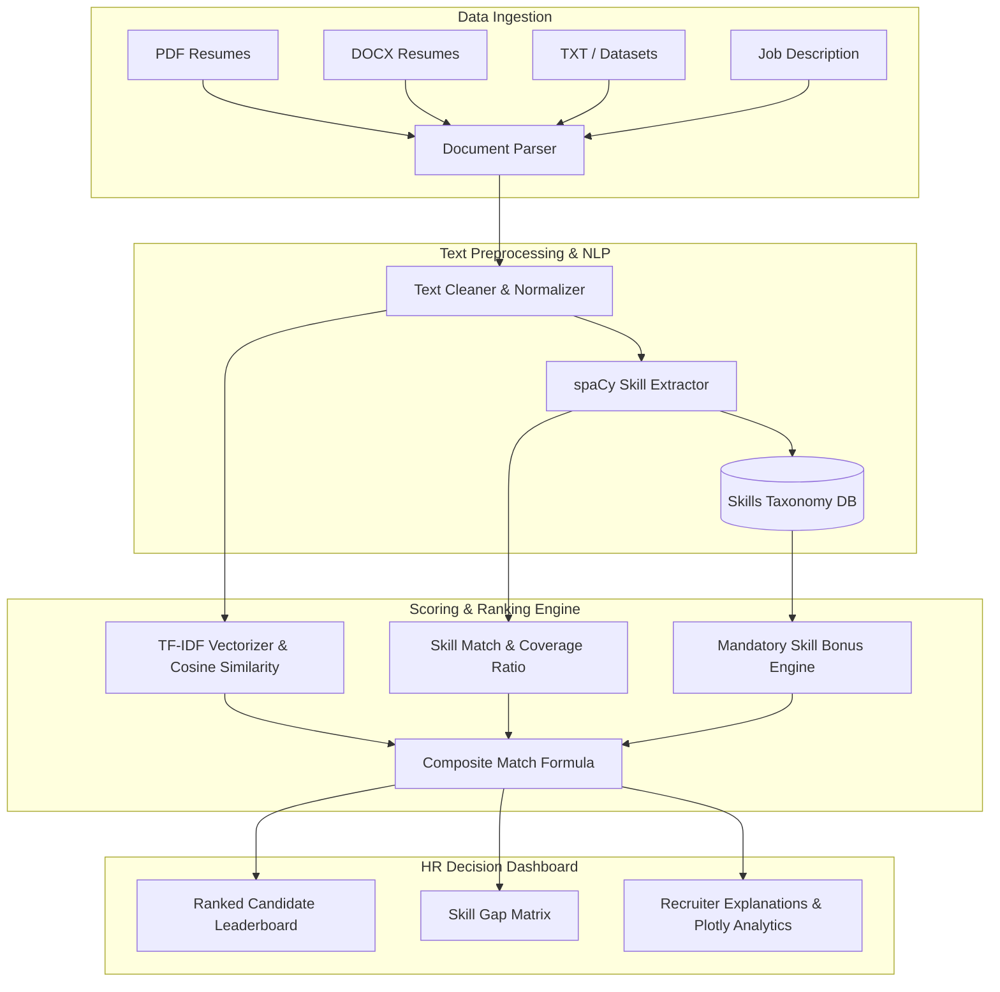

# 🔍 AI-Powered Resume Screening & Candidate Ranking System
> **Task 3 - Machine Learning & NLP Decision-Support System**  
> Built for **Future Interns** ML Program | HR-Tech Automated Recruitment Platform

---

## 📌 Executive Overview
Hiring managers receive hundreds of resumes for every job opening. Manually screening each candidate is slow, subjective, and prone to human bias. 

This repository contains an end-to-end **Machine Learning & Natural Language Processing (NLP) Resume Screening System**. The platform automatically ingests resume documents (PDF, DOCX, TXT), extracts technical competencies using spaCy entity matching, evaluates candidate role fit using **TF-IDF vectorization** and weighted skill scoring, ranks candidates on a live leaderboard, and highlights actionable **skill gaps** for non-technical recruiters.

---

## ✨ Key System Features

- 📄 **Multi-Format Document Parser**: Ingests PDF, DOCX, and TXT resumes or bulk datasets effortlessly.
- 🧹 **Robust NLP Text Preprocessing**: Cleans unstructured text, strips URLs/emails, normalizes punctuation, and preserves technical syntax (`C++`, `C#`, `.NET`, `Node.js`, `React.js`, `CI/CD`).
- 🎯 **Domain-Specific Skill Extractor**: Powered by spaCy `PhraseMatcher` and a curated skill taxonomy covering Data Science, Software Engineering, Cloud/DevOps, Databases, and Soft Skills.
- 📊 **Multi-Metric Candidate Scoring Engine**:
  - **TF-IDF Cosine Similarity**: Evaluates semantic/contextual alignment with job descriptions.
  - **Skill Coverage Ratio**: Calculates exact coverage percentage of required role competencies.
  - **Mandatory Skill Weighting**: Applies recruiter-defined priority filters for core requirements.
  - **Composite Role Fit Score**: Combines metrics into an intuitive 0–100% role fit score.
- 🏆 **Candidate Leaderboard & Visual Analytics**: Interactive Streamlit Web UI featuring Plotly leaderboard bar charts, multi-metric radar comparison, and downloadable CSV reports.
- 💡 **Skill Gap & Non-Technical Recruiter Explanations**: Automatically identifies missing vs. matched skills and generates easy-to-understand executive summaries for HR teams.

---

## 🏗️ System Architecture



---

## 📂 Repository Structure

```
FUTURE_ML_03/
├── app.py                          # Streamlit Interactive Web Application
├── requirements.txt                # Python package dependencies
├── README.md                       # Comprehensive project documentation
├── .gitignore                      # Git exclusion rules
├── src/
│   ├── __init__.py                 # Package initializer
│   ├── text_cleaner.py             # Preprocessing & text normalization module
│   ├── parser.py                   # Multi-format document reader (PDF, DOCX, TXT)
│   ├── skill_extractor.py          # spaCy-powered NLP skill extraction engine
│   ├── matcher.py                  # TF-IDF, Cosine Similarity & Ranking logic
│   └── visualizer.py               # Plotly & Matplotlib dashboard visualizer
├── data/
│   ├── skills_db.json              # Curated skills taxonomy database
│   ├── sample_job_descriptions/    # Benchmark JDs (Data Scientist, Fullstack, DevOps)
│   └── sample_resumes/             # Benchmark candidate resumes cohort
├── notebooks/
│   └── resume_screening_system.ipynb # Complete step-by-step Jupyter Notebook
└── tests/
    ├── test_cleaner.py             # Unit tests for text cleaner
    ├── test_extractor.py           # Unit tests for skill extractor
    └── test_matcher.py             # Unit tests for candidate matcher
```

---

## 🚀 Quick Start Guide

### 1️⃣ Clone the Repository & Install Dependencies
```bash
git clone https://github.com/your-username/FUTURE_ML_03.git
cd FUTURE_ML_03

# Install dependencies
pip install -r requirements.txt

# Download required spaCy and NLTK language data
python -m spacy download en_core_web_sm
python -c "import nltk; nltk.download('stopwords'); nltk.download('punkt'); nltk.download('punkt_tab')"
```

### 2️⃣ Run the Interactive Web Dashboard
Launch the Streamlit web dashboard in your browser:
```bash
streamlit run app.py
```
- Open `http://localhost:8501` to test resume uploads, change job description targets, adjust scoring weights, and inspect skill gap reports!

### 3️⃣ Run Jupyter Notebook Analysis
Explore the step-by-step NLP modeling notebook:
```bash
jupyter notebook notebooks/resume_screening_system.ipynb
```

### 4️⃣ Run Automated Unit Tests
Verify model logic and test coverage using `pytest`:
```bash
python -m pytest tests/
```

---

## 🧮 Candidate Scoring & Ranking Formula

The composite **Role Fit Score ($S_{overall}$)** is calculated as a weighted linear combination:

$$S_{overall} = \left( w_{tfidf} \cdot S_{tfidf} + w_{skills} \cdot S_{skills} + w_{mandatory} \cdot S_{mandatory} \right) \times 100$$

Where:
- $S_{tfidf}$: Cosine similarity between TF-IDF feature vectors of cleaned resume and job description text.
- $S_{skills}$: Jaccard coverage ratio of matched job description skills ($\frac{|\text{Matched Skills}|}{|\text{Total JD Skills}|}$).
- $S_{mandatory}$: Percentage of recruiter-specified mandatory skills present in candidate resume.
- $w_{tfidf}, w_{skills}, w_{mandatory}$: Configurable formula weights (default: $0.40, 0.40, 0.20$).

### Candidate Fit Tiers:
- 🟢 **Strong Fit ($\ge 78\%$)**: Excellent domain overlap and skill coverage. Top priority for interview.
- 🔵 **Good Fit ($62\% - 77\%$)**: Solid match with minor missing optional skills.
- 🟠 **Potential Fit ($45\% - 61\%$)**: Partial skill match; requires skill assessment.
- 🔴 **Low Fit ($< 45\%$)**: Significant skill gaps or non-relevant domain background.

---

## 📱 LinkedIn Showcase & Portfolio Sharing Guide

When sharing this project on LinkedIn to demonstrate your machine learning & software engineering capabilities:

1. 📸 **Record a 60-second video demo or post screenshots** of the Streamlit Leaderboard and Skill Gap Breakdown.
2. 📝 **Explain the business problem**: *"Hiring managers waste hundreds of hours manually screening resumes. I built an AI decision-support system using spaCy, TF-IDF, and Scikit-learn that ranks candidates in seconds and identifies skill gaps!"*
3. 🏷️ **Tag Future Interns**: Tag [@Future Interns](https://www.linkedin.com/company/future-interns/) and use hashtags `#MachineLearning #NLP #Python #Streamlit #HRTech #DataScience #FutureInterns`.

---

## 🤝 License & Author
Developed as part of the **Future Interns Machine Learning Internship (Task 3)**.  
Open-source under the MIT License.
